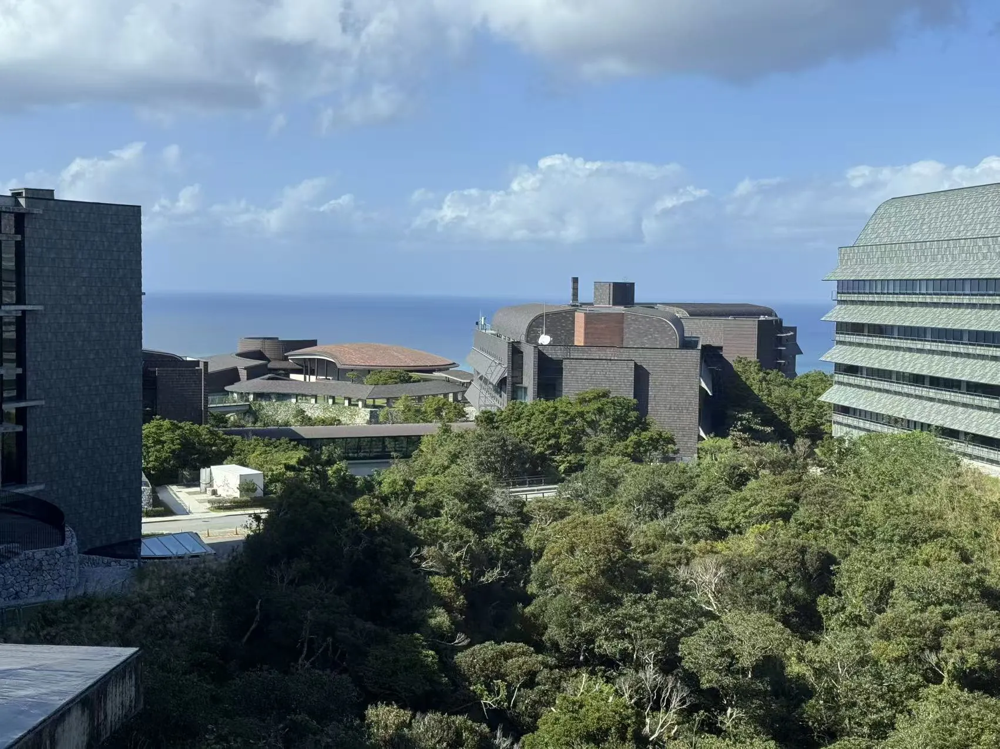

```{=html}
<div class="page-shell highlight-page">
<header class="page-header highlight-header">
<p class="highlight-meta"><span data-i18n="oist2026.visit">Research visit</span><time datetime="2026-11-04">2026.11.04</time></p>
<h1 class="page-title" data-i18n="oist2026.title" data-document-title>A seminar on double-stranded DNA viruses at OIST</h1>
</header>

<figure class="highlight-media">

</figure>

<section class="content-section">
<h2 class="content-label" data-i18n="detail.reflection">Personal note</h2>
<div class="prose-slot highlight-prose">
<p data-i18n="oist2026.intro">On 4 November 2026, I visited OIST to give a seminar on eukaryotic double-stranded DNA (dsDNA) viruses at the Evolution, Cell Biology, and Symbiosis Unit, hosted by Prof. Filip Husnik.</p>
<p><span data-i18n="oist2026.discussion.before">Beyond presenting our bioinformatic surveys on viral diversity and endogenous viral elements, I had a great time discussing the sheer weirdness of </span><strong data-i18n="oist2026.discussion.hosts">protists and invertebrates</strong><span data-i18n="oist2026.discussion.after"> with the group. Exploring how viruses and symbionts interact with these diverse hosts is genuinely fascinating—every lineage seems to play by its own evolutionary rules.</span></p>
<p data-i18n="oist2026.thanks">Many thanks to Filip and his team for the lively discussions, great questions, and warm hospitality in Okinawa!</p>
<nav class="highlight-links" aria-label="Record sources" data-i18n-aria-label="detail.links.aria">
<a href="https://groups.oist.jp/ecbsu/event/seminar-hidden-world-dsdna-viruses-eukaryotes-diversity-host-associations-and-cryptic" target="_blank" rel="noopener noreferrer" aria-label="OIST seminar announcement (opens in a new tab)" data-i18n-aria-label="oist2026.source.aria"><span data-i18n="oist2026.source">Seminar announcement</span> <span aria-hidden="true">↗</span></a>
</nav>
</div>
</section>

<section class="highlight-docket" aria-labelledby="oist-docket-title">
<p class="highlight-docket-label" id="oist-docket-title" data-i18n="detail.summary">Record sheet</p>
<dl class="highlight-facts">
<div><dt data-i18n="detail.meta.talk">Talk</dt><dd lang="en">The hidden world of dsDNA viruses in eukaryotes: diversity, host associations, and cryptic lifestyles</dd></div>
<div><dt data-i18n="detail.meta.organization">Organization</dt><dd data-i18n="oist2026.host">Evolution, Cell Biology, and Symbiosis Unit, OIST</dd></div>
</dl>
</section>

<nav class="highlight-back" aria-label="Back to notes" data-i18n-aria-label="detail.back.aria">
<a href="../../index.html#coverage"><span aria-hidden="true">←</span> <span data-i18n="detail.back">Back to notes</span></a>
</nav>
</div>
```
